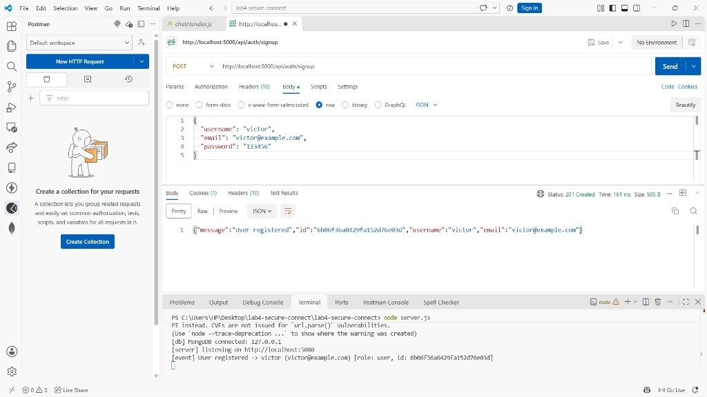
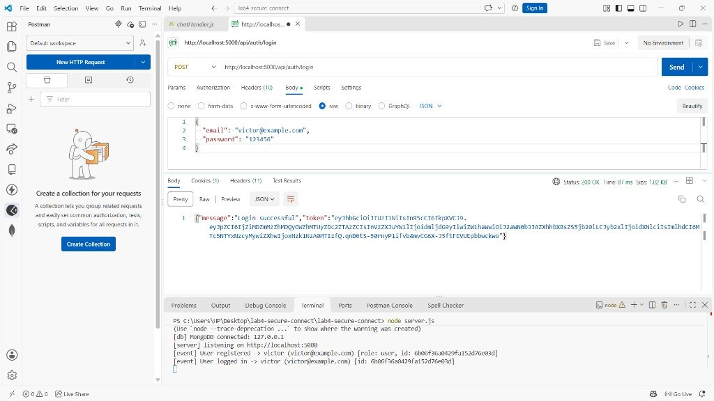
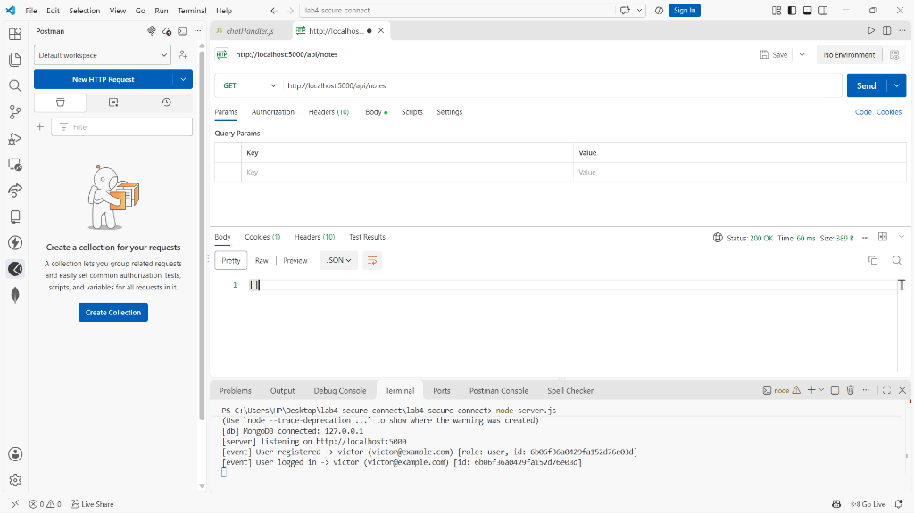
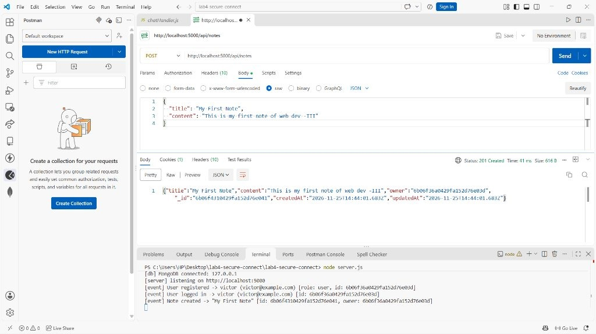
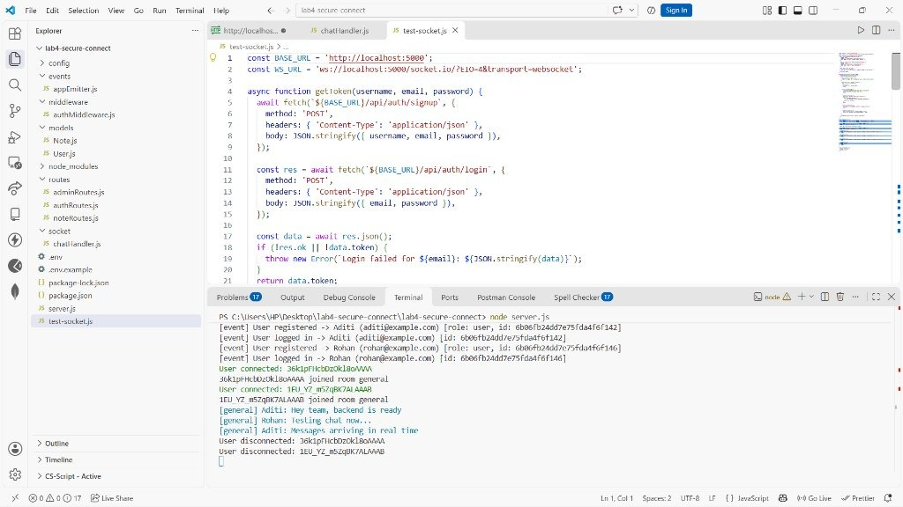

# Assignment 4

**Secure Connect and Communication Platform** — A backend application built with **Node.js**, **Express.js**, **MongoDB (Mongoose)**, **JWT (`jsonwebtoken`)**, **bcrypt**, **dotenv**, and **Socket.IO**, implementing stateless authentication, protected Notes operations, event-driven logging via `EventEmitter`, and real-time room chat without relying on pre-built authentication boilerplates or starter kits.

---

## Core Backend Features

- **User Signup & Login:** Passwords are salted and hashed with `bcrypt` before persistence in MongoDB (`User` model) and verified with `bcrypt.compare` during login.
- **Stateless JWT Authentication:** Login issues a signed JWT (`jsonwebtoken`) returned in the JSON response and stored as an `HttpOnly` cookie; protected routes accept either `Authorization: Bearer <token>` or the `token` cookie.
- **Protected Notes API:** Authenticated endpoints (`/api/notes`) allow users to create and retrieve their personal notes stored in MongoDB with ownership tracking and timestamps.
- **Real-Time Communication (Socket.IO):** Authenticates WebSocket connections during the Socket.IO handshake using the user's JWT, supports room joining (`joinRoom`), and broadcasts real-time messages (`chatMessage`) within rooms such as `general`.
- **Event-Driven Architecture (`EventEmitter`):** Decouples side effects (registration, login, note creation audit logs, and chat history tracking) from controllers using Node.js's built-in `events` module.

---

## Installation & Execution

1. Ensure MongoDB is running locally on `127.0.0.1:27017`.
2. Install dependencies and start the server:
   ```bash
   npm install
   node server.js
   ```
   Expected startup output:
   ```text
   [db] MongoDB connected: 127.0.0.1
   [server] listening on http://localhost:5000
   ```
3. To test the real-time Socket.IO chat simulation in a second terminal:
   ```bash
   node test-socket.js
   ```

---

## API Endpoints

| Method | Endpoint | Access | Description |
| :--- | :--- | :--- | :--- |
| `POST` | `/api/auth/signup` | Public | Register a new user (`username`, `email`, `password`) |
| `POST` | `/api/auth/login` | Public | Verify credentials and issue JWT (`token`) |
| `POST` | `/api/notes` | Protected | Create a personal note (`title`, `content`) for the logged-in user |
| `GET` | `/api/notes` | Protected | Retrieve all notes owned by the authenticated user |

---

## Analytical Report

### 1. Security & Authentication Design
- **Password Storage:** Plaintext passwords are never stored or returned in API responses (`select: false` on the `password` field in the Mongoose `User` schema). A Mongoose `pre('save')` hook automatically generates a 10-round salt and hashes passwords via `bcrypt` only when the password field is modified.
- **Stateless Sessions with JWT:** Rather than maintaining server-side session state, `POST /api/auth/login` signs a compact payload (`id`, `username`, `email`, `role`) with an expiration window. Every protected request is verified cryptographically via `jwt.verify()` inside `verifyToken`.
- **Access Control & Ownership:** Requests to `/api/notes` without a valid token are rejected before reaching route handlers (`403 Forbidden` when missing, `401 Unauthorized` when invalid). Authenticated requests scope `GET /api/notes` and `POST /api/notes` strictly to `req.user.id`.

### 2. Event-Driven Architecture (`EventEmitter`)
- Domain events (`user:signup`, `user:login`, `note:created`, and `chat:message`) are emitted from route and socket handlers and handled centrally by `AppEmitter` (extending Node.js `EventEmitter`).
- This keeps HTTP controllers focused strictly on validation, persistence, and status codes while allowing audit logging and chat history tracking to remain decoupled from request handling.

### 3. Real-Time Communication (Socket.IO)
- **Handshake Security:** Socket connections pass through `io.use()` middleware before entering the `connection` handler, ensuring only JWT-authenticated users can join rooms or send messages.
- **Room Isolation:** Using `socket.join(room)` and `io.to(room).emit('chatMessage', ...)` restricts message delivery exclusively to clients subscribed to the target room (`general`).

### 4. Testing Observations
- End-to-end verification in Postman and Node.js confirmed correct HTTP status semantics (`201 Created` on signup and note creation, `200 OK` on login and note retrieval), clean MongoDB persistence with automatic `createdAt`/`updatedAt` timestamps, accurate `EventEmitter` console audit trails, and low-latency bidirectional message delivery across concurrent Socket.IO clients (`Aditi` and `Rohan`).

---

## Screenshots & Execution Walkthrough

### 1. User Registration (`POST /api/auth/signup`)
Registers a new user (`victor`) with a `bcrypt`-hashed password in MongoDB, returns `201 Created` with the user's ID, username, and email, and triggers the `[event] User registered` `EventEmitter` log in the server terminal.



### 2. User Login & JWT Issuance (`POST /api/auth/login`)
Verifies the user's email and password against the stored `bcrypt` hash, returns `200 OK` with a signed JWT token (and sets the `token` cookie), and logs `[event] User logged in` in the terminal.



### 3. Protected Notes Check Before Creating Notes (`GET /api/notes`)
Sends an authenticated `GET` request to `/api/notes` using the issued JWT cookie/token, returning `200 OK` with an empty array `[]` since the user has not created any notes yet.



### 4. Creating a Personal Note (`POST /api/notes`)
Creates a new note (`"My First Note"`) associated with the authenticated user's `owner` ID, returns `201 Created` with `_id`, `createdAt`, and `updatedAt` timestamps, and triggers `[event] Note created` in the terminal.



### 5. Retrieving Authenticated User's Notes (`GET /api/notes`)
Fetches all notes belonging to the logged-in user (`victor`), returning `200 OK` with the persisted note array from MongoDB.


### 6. Real-Time Chat Activity via Socket.IO (`node server.js` + `node test-socket.js`)
Demonstrates two JWT-authenticated users (`Aditi` and `Rohan`) connecting to the Socket.IO server, joining the `general` room, exchanging real-time messages logged in the terminal, and cleanly disconnecting afterward.


